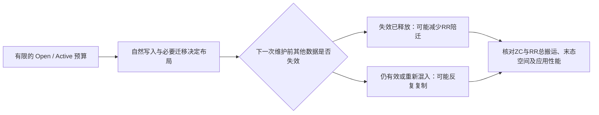

# 面向 JSA 的论文写作蓝图

整理日期：2026年11月9日。性质：根据当前研究计划、实现与归档证据形成的写作建议，不是已定稿贡献或实验结论。本轮不修改 `overleaf/main.tex`，不启动或接管实验，不更换研究方法。

## 1. 建议把论文集中到这个问题

**有限 Zone 资源下，怎样组织读热点与其他有效数据，使后续 ZC 和 RR 的总搬运更少？为什么一次看起来有利的共置，经过必要迁移和普通回退后又会变贵？**

对应的暂定英文研究问题：

*Under limited open and active zone budgets, when can cooperative data placement reduce the combined data movement of zone cleaning and read refresh?*

这是待回答的问题。当前最值得展开的机制认识是：**读热度、文件失效和 Zone 维护分别发生在不同时间尺度上，最终成本取决于整个布局演化过程，而不只取决于首次放置标签或一次目标选择。** 这是对现有证据的组织建议，还不是已完成的新颖性认定或普遍定律。

这条主线仍服务根目录[研究计划](../../ZNS_GC_RR_Research_Plan.docx)的目标：降低可比工作量下累计 ZC+RR 迁移，核对空间与性能。计划书是范围依据，当前结果是主张依据；计划中的动态K、在线寿命预测和联合选择器不能自动写成已经完成。

## 2. 当前证据支持什么，不能支持什么

以下数字来自既有归档派生核验，本轮未重跑。精确字节、文件身份与本次读取范围见 `evidence-snapshot.json`。它记录来源身份，不等于重新完成原始归档的全部审计。

|证据|目前能够支持的表述|不能扩大成的结论|
|---|---|---|
|第四阶段G0/G1/G2完整输入，均2,260,992请求；同轮Greedy及配置|受控开发负载中，放置路径能改变后续维护成本|一般负载/任意并发下都有同样收益；统计显著性|
|同轮总复制：G0 1,236.030MiB；G1 1,250.019MiB；G2 616.995MiB|G2相对G0少50.08%，相对G1少50.64%，是该轮整体轨迹观察|最终方法稳定减少50%；跨不同构建/轮次拼接收益|
|同轮RR次数为15/14/15，RR复制766.299/1,200.728/545.315MiB|减少单次RR携带的有效数据，可以比减少RR次数更重要|已经消除了H本身的刷新；ZC一定替代了某次RR|
|G2比G1复制更少，但同轮吞吐低6.69%，部分深尾延迟更差|维护量与应用性能需要分别检验|所有指标最优；把该吞吐差已确定归因为放置算法|
|第五阶段17次H入池涉及两个文件；5段观察中已登记W在下一RR前全部释放；1段末端截尾|机会确实存在，但时序和存活条件不同|17个不同样本、5次独立统计重复；把截尾算成功|
|第五阶段H9/H12入池时目标较轻，后续旧W迁回H旁|目标组成必须沿后续分配/迁移跟踪|只看H进入瞬间就能判断是否有净收益|
|G2_WMIG_OFF与H普通目标候选均有功能与配对记录，但未证净收益，且策略前已有路径分歧|局部拒绝或排序不足以保证整体收益；可作为动机/边界材料|用单对总量差直接判定新规则的因果损失；将失败候选藏起来|
|W历史准入设备补测通过；当前状态文件仍将业务收益标为未确认|已有提交历史的W-only门控是可测试候选，重挂载后历史未知|它就是最终方法；它准确识别长寿命W；业务收益已成立|
|外部基线六臂短前缀通过；完整轮自动收尾状态为controller failure且results_claimed=false|已有适配与前缀证据，完整统一比较尚未收齐并发布|已优于CAZA/OAZA-GC/ColdMap；把已完成的部分臂当完整排名|

来源按本次读取状态冻结；“运行中”等字样是文件记录，不是本轮实时进程判断。原研究计划要求先做Greedy重复的旧段落，已被用户2026年11月5日后续要求覆盖：不自动增加Greedy独立重复组。

## 3. 两种写作范围，以及当前建议

|范围|优点|当前缺口与风险|
|---|---|---|
|**建议优先准备：固定资源预算下的放置与迁移机制论文**|第四/五阶段已有放置消融、实际生命周期和失败边界，可形成紧凑故事|需冻结最终准入规则，完成同版本外部比较与适用范围验证；不能承诺所有性能提升|
|研究计划的完整联合方案：放置+联合ZC选择+动态资源|覆盖原始长期目标，更完整回答形成机会与兑现机会|现有正向放置消融实际采用Greedy；未证明三者的独立增量，容易把不同版本和候选堆成完整系统|

建议先按第一种组织材料，保留第二种作为有条件扩展；**不据此取消或修改研究目标**。只有同版本证据显示联合选择有额外贡献，才把选择器升级为中心机制；只有不同阶段的有利K确实变化且调整值得，才把自适应K纳入正文。否则固定K是可解释的设计选择，不必为了论文看起来复杂而增加模块。

W历史门控也有同样条件：若完整配对与后续验证支持净改善，可进入最终设计；若只是转移复制，应保留为失败边界，不能把最终论文押在尚未返回的结果上。

## 4. 暂定标题与贡献怎样收敛

推荐工作标题：

**Resource-Constrained Data Placement for Zone Cleaning and Read Refresh in ZNS SSDs**

若最终证据聚焦于RR陪迁，可采用更窄的：

**Reducing Read-Refresh Data Movement through Cooperative Placement in ZNS SSDs**

第二个标题中的Reducing只有在最终版本与范围验证支持时才使用。现有 `GC--RR Cooperative Data Placement and Zone Cleaning for ZNS SSDs` 暂不修改；后续正文必须解释GC/ZC所在层次。

贡献建议保留三项，并分别设证据门槛：

1. **机制刻画**：辨别共置何时减轻RR携带数据、何时因长期存活和再迁入失效。已有具体事件支持；泛化范围仍需限定。贡献不是“做了日志”，而是日志揭示了什么可重复检查的机制。
2. **放置机制**：在固定资源和强制RR语义下，通过自然写入及必要迁移选择目标，维护资源/代际与安全回退。已有G0/G1/G2实施与功能证据；最终准入版本尚需定案，不预写不存在的预测器或新选择器。
3. **有边界的验证**：以同轮消融、生命周期与外部对照说明成本来源，并同时报告空间与性能代价。现有证据可支持局部部分；完整统一基线和泛化未完成，不能提前写成已优于现有工作。

“首次共置”“首次应用感知分配”“完全消除RR”“提高可靠性/SSD寿命”都不作为当前贡献。SWEEP全文未读完，新颖性边界仍待补查；不因为本轮已有三篇精读就宣布相关工作检索完成。

## 5. 让整篇文章沿同一条证据链推进

建议读者依次看到：**空间回收和读刷新会搬相同有效数据 → 数据如何放影响以后搬多少 → 有利共置有明确时序条件 → 必要迁移/回退会改变这些条件 → 设计必须控制完整路径 → 总量、空间与性能共同判断是否值得。**

图中是写作问题关系，不是新增算法流程；“可能”需要真实事件与对照回答。

### Introduction：建议五个段落任务

|段落|只承担一个任务|需要控制的表述|
|---|---|---|
|I1|说明RocksDB/ZenFS上的ZC和本项目RR为何带来搬运|不长篇铺SSD发展史；RR模型范围尽早交代|
|I2|引出放置与后续维护耦合：少ZC未必少总复制|用已确认现象，不把成本迁移包装成全局优化|
|I3|概括已有工作解决了什么：寿命放置、compaction感知清理、细粒度刷新|准确承认OAZA/ColdMap/FineRR；SWEEP待全文，不先写其细节缺陷|
|I4|收窄到资源限制、失效时序与必要迁移/回退的具体问题|不以“还没有我们的方法”定义缺口|
|I5|给最终方法的核心选择、评估范围与三项贡献|最后定稿；不提前填新准入和外部比较的收益|

语言上先用aim/study表研究目标；对已取得的观测才能用observe/show。新颖性尚未核清时不用first，准确率没有独立测量时不称accurate。

### Background and Problem Definition

三小节即可：系统与维护责任；数据特征、资源与放置单位；成本目标及观察窗口。必须区分逻辑更新、SST退役、extent释放、复制、映射提交和Reset；同Zone不自动等于同物理Block。

成本可以先给**测量定义**，不提前冒充最终评分公式：

$$M(\mathcal{T})=M_{ZC}(\mathcal{T})+M_{RR}(\mathcal{T}),\qquad M_x(\mathcal{T})=\sum_{e\in E_x(\mathcal{T})}b_e.$$

这里 $\mathcal{T}$ 表示统计窗口，$E_x(\mathcal{T})$是窗口内已执行的维护复制记录，$b_e$是实际复制的有效数据字节；相同数据重复制多次，成本计多次。撤销副本若已实际复制也计实际搬运，映射成功量、失败及重试另外列；逻辑有效字节不冒称页对齐后的物理写入量。本轮未因此重算历史数字。

统计窗口不用字母W，以免与数据类别W混淆；字节、事件和窗口定义需与最终分析器完全一致。空间、尾损和性能独立报告，**不从M中直接扣空闲字节**。

### Motivation and Design Challenges

围绕三项观察写三段：第一，有效的同区数据失效能让下一RR只搬H；第二，旧W仍有效并反复迁回，首次标签不足；第三，普通回退及后续追加可重新形成高成本区。每段只放必要事件和一个设计需求，余下完整链留源数据。

观察1引出覆盖必要H迁移；观察2引出对迁移历史/失效证据的审慎使用；观察3要求解释整个回退和后续分配链。不能从观察3直接声称当前候选已经解决它。

### Design and Implementation

沿“输入信息 → 固定K池 → 新写入/必要迁移准入 → 目标与回退 → 复制/提交/生命周期”讲清最终版本。每个模块回答为何需要、做什么、由哪组消融检验。观测与评分输入分开，不让离线未来退役信息进入在线决策。

W历史如果被采用，准确名称是本挂载会话内成功迁移提交证据；它既非长寿命oracle，也不跨重启恢复。全量拒绝W和H普通排序候选不同时堆入最终方法；原Greedy与联合选择器也分别命名、记录配置。

### Evaluation：先列问题，再选图

|小节建议|要回答的问题|现有证据与缺口|
|---|---|---|
|Setup and Measurement Boundaries|比较的是哪些版本、输入、初态、窗口与延迟口径|第四阶段可写具体设置；不同方法的15%/20%触发差异不能隐藏|
|Overall Maintenance Cost and Space|总搬运下降吗，是否以空间债务换来|第四阶段支持受控一轮；最终规则和外部完整对照待核验|
|Placement Ablations and Data Lifetimes|收益来自哪些路径，是否只是换类别或延期|G0/G1/G2与第五阶段事件；保留截尾和代价|
|Admission and Fallback Boundaries|新准入有没有真正改变目标，是否引发别处复制|两次未证收益候选提供边界；W历史结果待定|
|Performance and Overhead|少搬运是否改善应用体验，有何开销|API、队列/完成与aux路径分开；现有aux原因未闭合|
|Sensitivity and Scope|结论在哪些预算、负载和分类条件下成立|固定K以外的范围尚需证据；此表不授权自动补跑|

### Related Work / Discussion / Conclusion

相关工作按决策位置组织：分配期寿命/OR、清理期未来compaction、RR粒度/读热共置、资源管理。DZR/SWEEP没有完整阅读就不补机制细节。正文只比较已核验的机制，参考文献库后续逐条核验再加入。

Discussion解释哪些情况下共置失效、来源标签局限、阈值RR模型边界、未持久化状态、并发归因与测量窗口。Conclusion最后写，只保留最终版本在已测范围内成立的结论。

## 6. 图表建议：先做能推动论点的图

|候选|读者要看懂什么|可用来源/缺口|建议位置|
|---|---|---|---|
|图1：分层系统与两条分配路径|谁观察H/W、谁分配、谁执行ZC/RR|最终源码需核验；可先画标明候选的草图|Background/Design|
|图2：成功与失败的实际生命周期并排|W先释放与旧W再混入为何不同|第五阶段H1与H9/H12；标事件和代际、截尾|Motivation|
|图3：G0/G1/G2的ZC+RR堆叠及末态空间|分项下降不等于总量下降|第四阶段同轮数据，旁注单轮受控；不能同轴相减|核心消融|
|图4：RR每轮组成或重复复制链|RR次数与每次携带有效量分开|15次RR分类与原始复制事件|机制分析|
|图5：最终方法/外部基线总成本与空间|最终改进是否超过当前方法|完整对照尚不齐；先留问题，不生成虚构柱状图|Overall结果|
|图6：应用完成/API/Flush分解及延迟|避免把aux差异说成介质或算法收益|已有分段，原因未确认；按最终统一观测选择|Performance|
|表1：系统/负载/规则设置；表2：方法差异|保证读者知道比较变量|源身份完整细节留仓库；歧义变体明确分列|Setup|

当前优先准备图1、图2、图3的资料。图编号是工作规划，尚未改正文引用或生成结果图。K敏感性图只在有真实结果时加入；不为凑图数扩实验。

## 7. 正文与附录的取舍

|材料|论证角色|安排|
|---|---|---|
|放置改变RR携带量的直接事件|core discovery|Motivation与机制结果，避免完整数字重复|
|复制—映射—Reset一致性和身份|necessary support / provenance detail|正文简述核验边界，细清单与逐事件数据放仓库/补充|
|G1/G2性能反向、成本转移与截尾|qualification|会改变解释，必须在主文可见|
|两次失败候选的全部开发记录|boundary / provenance|主文保留它揭示的关键边界，其余不按阶段时间线逐项堆叠|
|启动失败、SSH路径、ABI诊断|provenance detail|保留工程证据，通常不进论文主线|
|候选公式歧义与适配差异|necessary support|Setup明确变体，复现说明展开；不藏到读者找不到的位置|

本轮没有正文重写，删除/移动日志为“不适用”，正文词数变化为0。后续主要效应数字在一个结果表/图中统一给全，摘要与结论只各保留概括，图注主要说明读法与条件，不重复整段讨论。

## 8. 从哪里实际开始写

**第一小步建议：只写 §2.1 System Scope and Maintenance Semantics。** 先把RocksDB/ZenFS/FEMU、ZC与阈值RR的职责、有效数据/退役、测量层次写准；这些内容对最终W准入是否成功依赖较小。

第二小步写§2.2数据标签与资源定义，按实际冻结源码核对H/W/HW、K、Open/Active与安全回退；随后用既有真实事件写Motivation。再写最终实现、设置与结果，最后反写引言、摘要和标题。

每次一个小节：英文工作段落 → 简短中文核对要点 → 事实/来源/缺口 → 语言复查。沿用[语言精读约定](../reading/20261109-zns-deep-reading/language/README.md)：术语不漂移、estimated不改成measured、目标不改成结果、条件紧邻主张。

此次交付停在蓝图，未擅自开始该小节；用户目前要先思考怎么写，下一次起草以这份蓝图和已确认事实为起点。也未生成摘要数字、向Overleaf同步或启动实验。最终准入版本、完整外部比较、SWEEP全文和正式范围验证仍是未确认项。
